<p align="center">
  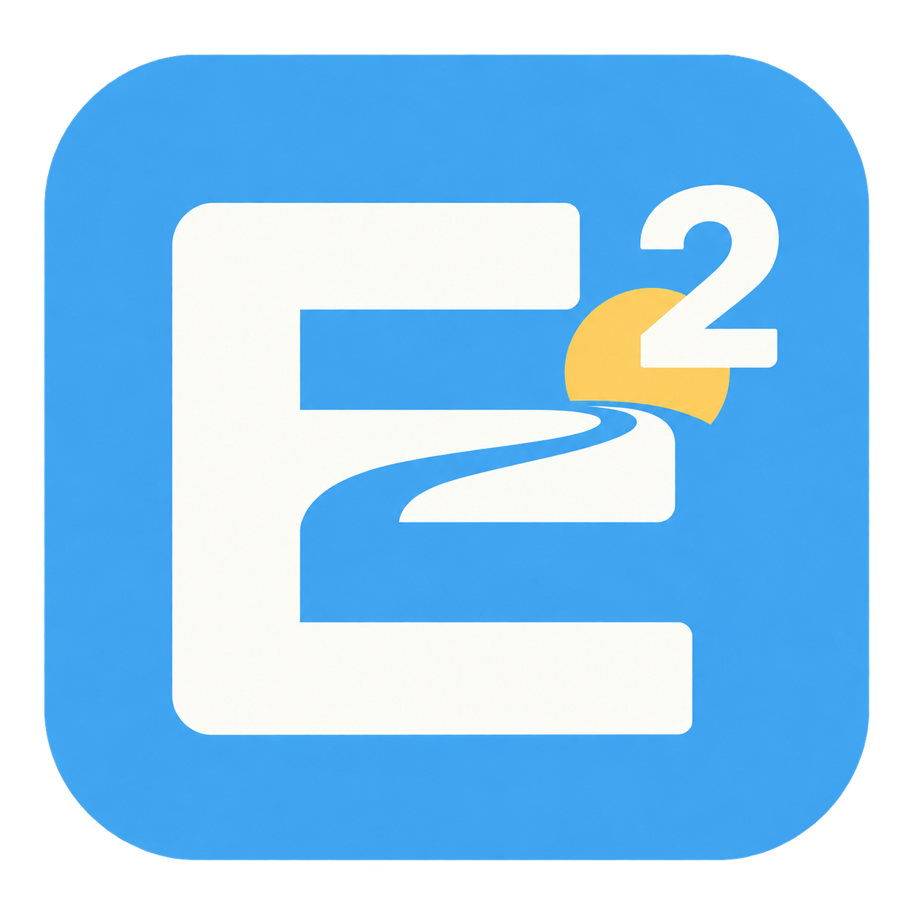
</p>

# E²-Day · 探索每一天

**新增独立的 [E²-Day 家教版 1.2.0](https://github.com/yilaxin/E2-Day/releases/tag/tutor-v1.2.0)**：授课日历、学生档案、课后图文反馈、每周排课与课时收入统计。与日常版分别运行、分别保存数据。详见[家教版使用说明](docs/TUTOR-GUIDE.md)。

| 家教版 Windows 下载 | 程序包 |
| --- | --- |
| Intel / AMD 64 位电脑 | [E2-Day-Tutor-v1.2.0-win-x64.zip](https://github.com/yilaxin/E2-Day/releases/download/tutor-v1.2.0/E2-Day-Tutor-v1.2.0-win-x64.zip) |
| ARM64 电脑 | [E2-Day-Tutor-v1.2.0-win-arm64.zip](https://github.com/yilaxin/E2-Day/releases/download/tutor-v1.2.0/E2-Day-Tutor-v1.2.0-win-arm64.zip) |

完整解压后运行 **E2Day.Tutor.exe**。以下原有说明与“下载最新版本”链接继续对应日常版。

家教版 1.2.0 新增“教学概览”：授课热力日历、课程执行趋势、学生课时排行、课后反馈跟进及当前学习需求分布，支持日期与学生筛选、点击图表进入记录或档案。延续学校、授课地点与学习标签，以及粉紫玻璃界面。桌面名称为 **E²-Day Teacher**，图标使用原版 E²-Day logo。运行文件名、包结构和下方教程中的操作继续沿用家教版规则。

第一次使用请先阅读[图文 PDF 教程](https://github.com/yilaxin/E2-Day/releases/download/tutor-v1.2.0/E2-Day-Tutor-Guide-v1.2.0.pdf)，新程序包内也附带“先读我.txt”和“安装与使用教程.pdf”。当前程序没有数字签名，Windows 首次运行时仍可能出现信誉提醒；教程说明来源核对、安全提示、账号、使用与备份步骤。

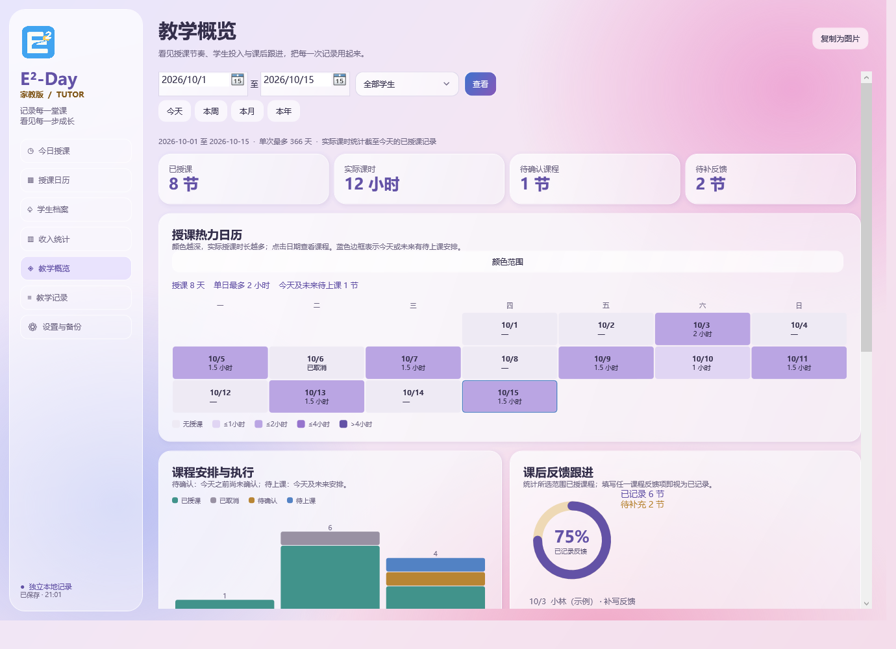

先体验再录入：在空白首页、空白教学概览或「设置与备份」点击 **“体验示例数据”**。独立窗口中有 6 位虚构学生、近三个月课程、收入、反馈与每周排课，可自由试用，关闭后丢弃本次修改，再次进入按当天重新生成。真实账号及备份保持原样。

家教版 1.2.0 同步原版近期通用改进：同窗口 3.2 秒可跳过开场、轻量玻璃卡片与缩略图／旧页面资源回收、按账号保存的授课小时热力色阶，以及按所选日期／学生生成的匿名教学概览分享图片。原有教学记录与示例体验继续保留。

**Explore Everyday Day** — 把全年安排、今天要做的事和已经完成的事，放进同一个 Windows 桌面 App，并通过手机主屏幕应用随身使用。

E²-Day 是一款中文个人任务与日历工具，适合记录工作计划、学习清单、生日纪念日和日常琐事。你可以先在日历里安排未来，再在今日清单里处理到期事项，最后通过历史记录回看完成情况。2.0 增加本机账号、独立手机主屏幕应用和手动文件交换。手机自己添加和保存任务，电脑与手机各自离线使用，需要交换记录时导出文件，在另一端预览并合并。

**[下载最新版本](https://github.com/yilaxin/E2-Day/releases/latest)** · **[详细使用说明](使用说明.md)** · **[反馈问题](https://github.com/yilaxin/E2-Day/issues)**

Windows desktop task planner, yearly/monthly calendar, recurring events, Chinese lunar dates and holidays, local history, backups and task sharing images. Chinese interface; personal records stay on your computer.

**新增鸿蒙原生版 0.1.1**：独立 ArkTS / ArkUI 应用，手机本机账号、离线任务与备注图片，手动与电脑交换 JSON。已在 Pura 70 / HarmonyOS 6.1 验证。公开构建为未签名 HAP，需用自己的开发者账号和设备签名；个人设备签名包不公开。[构建、签名及日常使用](docs/HARMONY-NATIVE.md)。既有网页手机入口继续使用。

**Windows 日常版 · 玻璃拟态界面**：粉紫柔光背景、半透明圆角卡片和蓝紫操作按钮，覆盖今日清单、全年／月历、历史、设置与编辑窗口。金色重要标记、完成淡化和原有记录继续保留。

**热力图颜色范围（2.1.8）**：在“数据概览 → 完成热力图 → 颜色范围”设置前三档上限。支持实时图例、高完成量预设、恢复默认及按账号保存，复制统计图片同步使用设置。

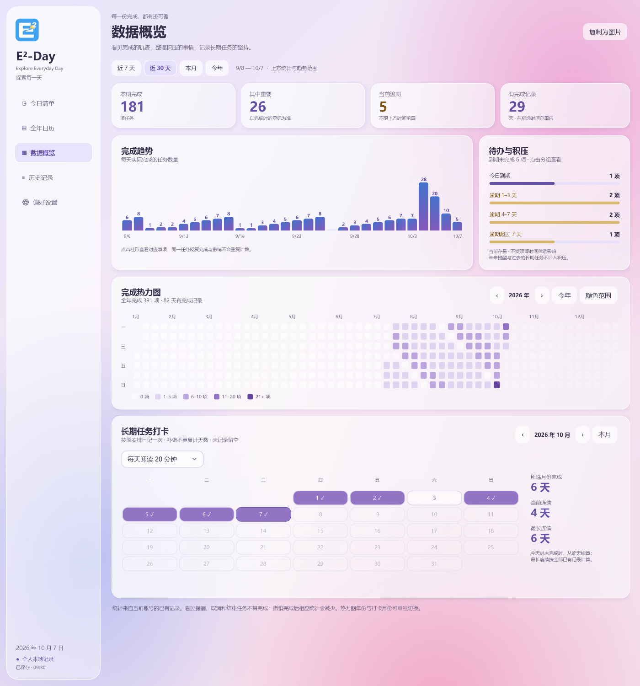

**新增数据概览（Windows 2.1.2）**：完成热力图、完成趋势、待办积压和长期任务打卡，支持点击图表查看、处理事项，沿用粉紫玻璃风格。

**隐藏页面与旧内容回收（2.1.11）**：年／月布局短时复用，离开约 45 秒后空闲释放；切页和刷新时拆离旧内容与图片引用，保留硬件加速、原粉紫主题及平滑滚动。[内存与连续滚动对照](docs/MEMORY-v2.1.11.md)。

**开场动画（Windows 2.1.10）**：先打开正常大小的主窗口，在窗口内播放约 3.2 秒的“向着朝阳出发”，道路延伸、朝阳升起并汇成 E²。从第一帧起点击任意位置即可跳过，也支持 Esc、Enter、空格；账号在后台同时读取，系统减少动画时显示短暂静态 logo。

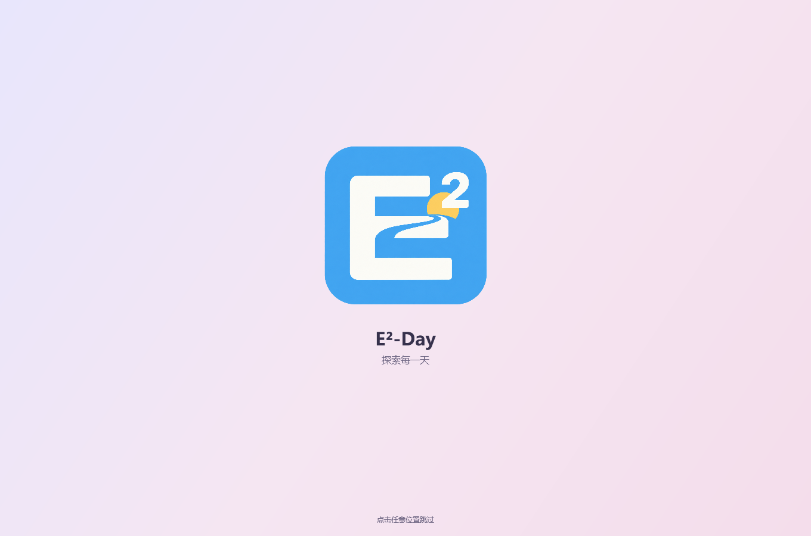

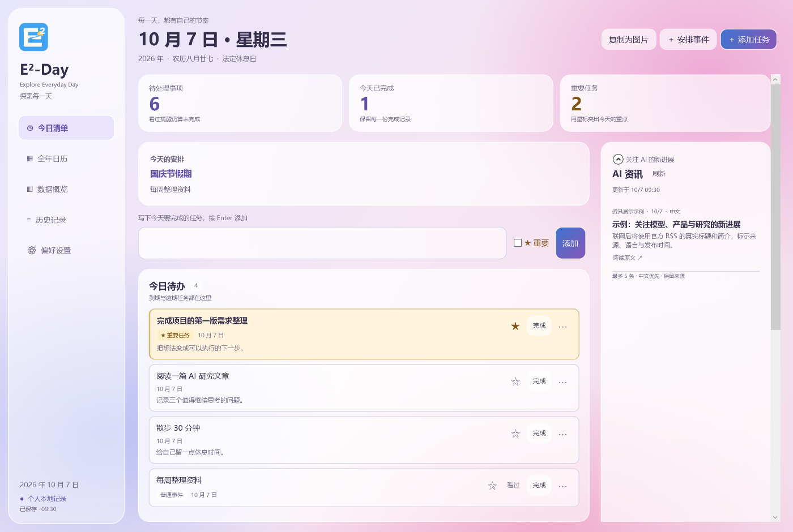

> 所有截图均由隔离的示例数据生成。首次运行时，个人任务清单为空；截图里的示例任务和资讯不会写入你的记录。

## 下载与开始使用

Windows 日常版：**2.1.11**，改进隐藏年／月视图与旧页面内容的回收，保留原粉紫玻璃风格、硬件加速、统一平滑滚动、自定义热力图区间、统计分享、任务与图文备注，以及约 3.2 秒的大窗口开场。鸿蒙原生版仍为 0.1.1。下方提供对应 Windows 程序包。程序采用免安装、自包含的文件夹发布方式，下载包内已包含所需的 .NET 运行依赖。

| 你的电脑 | 下载文件 |
| --- | --- |
| Intel / AMD 处理器的 64 位 Windows 电脑 | [E2-Day-v2.1.11-win-x64.zip](https://github.com/yilaxin/E2-Day/releases/download/v2.1.11/E2-Day-v2.1.11-win-x64.zip) |
| Snapdragon 等 ARM 处理器的 Windows ARM64 电脑 | [E2-Day-v2.1.11-win-arm64.zip](https://github.com/yilaxin/E2-Day/releases/download/v2.1.11/E2-Day-v2.1.11-win-arm64.zip) |

1. 在 Windows“设置 → 系统 → 关于 → 系统类型”中确认电脑架构，选择对应下载包。
2. **完整解压**到一个固定文件夹，保留程序旁边的 DLL、图标和 `Data` 文件夹。
3. 双击 `DailyRecord.exe`，打开后显示的 App 名称是 **E²-Day**。
4. 在“今日清单”输入一件事，按 Enter 添加；需要未来日期或重复安排时，点击“安排事件”。

鸿蒙原生未签名构建：[E2-Day-v2.1.0-harmony-unsigned.zip](https://github.com/yilaxin/E2-Day/releases/download/v2.1.0/E2-Day-v2.1.0-harmony-unsigned.zip)。这不是直接安装包，签名步骤见原生说明。

电脑端为 Windows 程序，没有 macOS、Linux 或 32 位 Windows 发布包。手机安装入口：[打开手机应用](https://yilaxin.github.io/E2-Day/mobile/)。首次联网准备完成后可添加到手机桌面，之后离线记录；华为 Pura 70 已验证桌面打开、断网保存与含图文件往返；其他手机浏览器尚未逐一真机验证，状态见[手机验收清单](docs/MOBILE-CHECKLIST.md)。Windows 发布包未做数字签名，Releases 提供 SHA256SUMS.txt 校验文件。

## 独立手机应用与文件交换

电脑和手机分别创建自己的本机账号、密码与离线恢复码。首次创建电脑账号会先备份旧版记录，再迁移到第一个账号；其余账号从空白清单开始。账号和密码不在交换文件中，两端可以使用不同账号名。

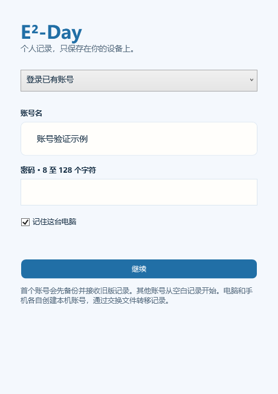

手机可新增任务，编辑日期、备注和图片，标记重要、完成或撤销，查看月历。电脑保留重复规则、全年总览、历史搜索、分享图片和资讯等完整功能。

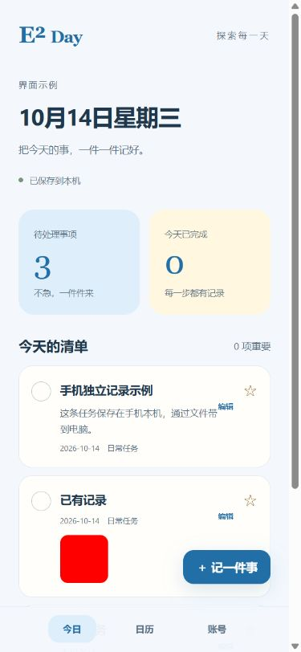

- 鸿蒙原生版由本人的开发者签名安装，之后独立离线运行；网页手机版通过固定 HTTPS 页面安装。两种方式均不依赖电脑开机、同一 Wi-Fi、配对码或本地连接证书。
- 电脑“偏好设置 → 手机与文件交换”、手机“账号 → 文件交换”可导出和导入交换文件，包含任务、事件、历史与被引用的图片。
- 导入先预览：保留双方独有记录，相同记录去重，同一条记录不同则选择“保留本机”或“采用文件”。采用整条记录的版本；文件中缺少某条任务不会删除本机任务。
- 确认合并前保留本机副本；文件损坏、缺图片、空间不足或预览后本机记录变化会拒绝导入，保留原记录。
- 记录只保存在各自设备，没有自动同步或云端账号。原生版请保留应用数据，网页手机版请保留站点数据；定期把交换文件另存为备份。

安装和文件交换步骤见[使用说明](使用说明.md)。华为真机已分别完成原生版及网页手机版的离线重开与含图文件往返；原生 0.1.1 的完成／撤销、点击流畅度和桌面名称也由用户复查通过。iPhone 尚未真机验证。

## 功能一览

| 功能 | 你可以做什么 |
| --- | --- |
| 本机账号（2.0） | 各设备独立记录、密码登录、离线恢复码 |
| 手机与文件交换（2.0） | 主屏幕图标、独立离线记录、含图文件导出、预览合并 |
| 今日清单 | 快速添加任务，标记重要，完成或撤销，编辑、改期、取消和恢复 |
| 备注图片 | 在任务或事件备注中上传多图、粘贴截图，点击缩略图放大，图片随历史与备份保存 |
| 逾期延续 | 未完成任务继续留在待办里，显示原定日期和逾期天数 |
| 提前提醒 | 日历事件按三档提前进入清单，默认提前 0 / 3 / 7 天 |
| 全年与月度日历 | 一眼看完整年，点击月份放大，按日期查看任务、农历、节日和调休 |
| 重复安排 | 每周、每月、每年公历或每年农历重复，支持修改单次或这次及以后 |
| 历史搜索 | 按日期回看实际完成情况，跨日期搜索标题、备注和历史操作 |
| 数据概览 | 完成热力图、趋势、积压与长期打卡，点击查看和处理对应任务 |
| 备份恢复 | 本机自动保存，运行当天自动备份，手动导出和恢复 |
| 分享图片 | 一键把今日待办与今日完成复制成图片，粘贴到聊天窗口 |
| AI 资讯 | 阅读公开 RSS 的标题、简介与原文链接，最多 5 条，中文优先 |

## 数据概览：看见完成与坚持

侧边栏“数据概览”包含四个部分：完成趋势（近 7 天／近 30 天／本月／今年）、全年完成热力图、按逾期天数分组的积压，以及可切换任务和月份的长期打卡月历。顶部数字展示本期完成、其中的重要任务、当前逾期与有完成记录的天数。

点击趋势柱形、热力格或积压分组可以查看对应事项；在详情中完成、撤销、编辑或改期后，统计会更新。长期任务的今天格可以打开“今日完成”操作，已完成格可以回看或撤销。

完成趋势和热力图按**实际完成日**归属，长期打卡按**原安排日**归属；看过提醒、取消与结束不等于完成，撤销完成后相应数据减少。未来提醒和过去遗漏的长期任务不会累积为逾期。当前积压不限时间，热力图年份和打卡月份单独切换，空白表示没有完成记录。

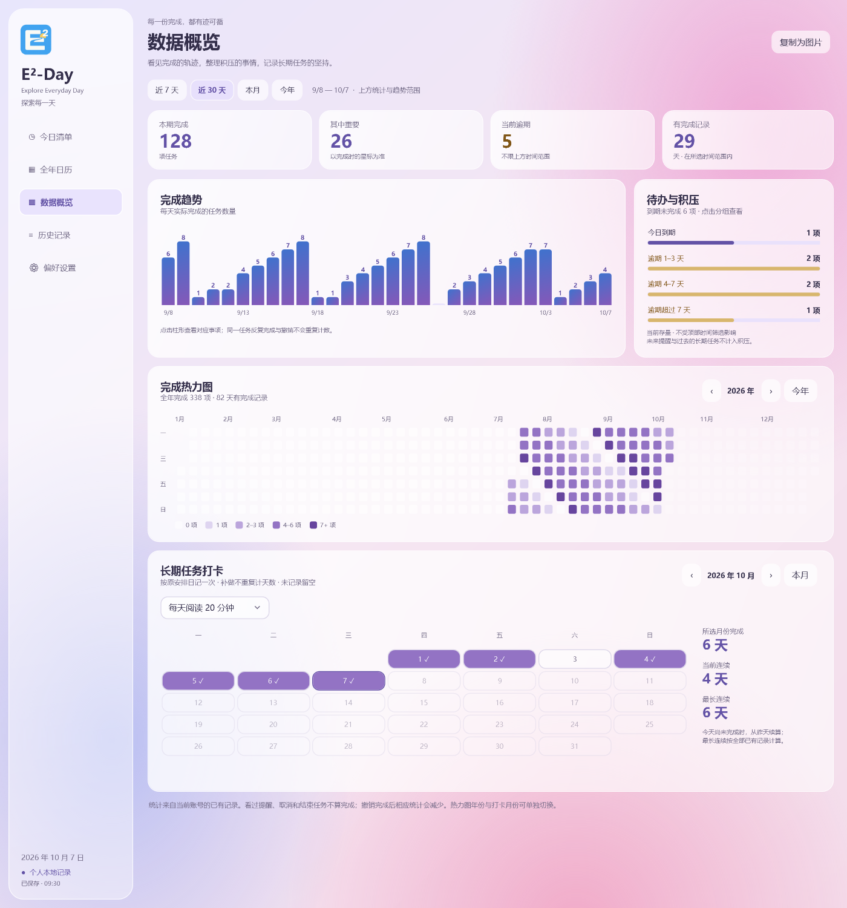

**日常版内存优化（2.1.7）**：备注列表复用小缩略图，原图按需读取，缓存限制为最多 64 项／4 MiB 像素；玻璃卡片采用轻量柔影，保持粉紫风格及平滑滚动。[内存对照与测量方法](docs/MEMORY-v2.1.7.md)。

**主要页面统一平滑滚动（2.1.6）**：今日清单、全年／月历和历史记录已加入与数据概览相同的连续平滑滚动，反向立即响应，切页或筛选会停止旧动画；日历缓存、日期弹窗及粉紫玻璃风格继续保留。

**数据概览平滑滚动（2.1.5）**：连续滚动会合并为连贯的短过渡，反向立即响应、停下迅速收住；支持细小滚轮增量，尊重 Windows 动画与滚动设置，保留图表和粉紫玻璃风格。

**数据概览滚轮修复（2.1.4）**：鼠标停在热力图或收起的长期任务选择框上，也能上下滚动整页；展开选择框后滚动选项列表，图表和玻璃风格保持原样。

**数据概览一键分享（2.1.3）**：在数据概览选择近 7 天、近 30 天、本月或今年，点击右上角“复制为图片”，即可在聊天窗口 Ctrl+V。图片包含统计与图表，热力图和长期打卡按同一范围排版；积压单独标明截至今天。带上当前选中的长期任务名称，不加入任务清单、备注图片或账号信息。

<details>
<summary>查看数据概览分享图示例（隔离数据）</summary>

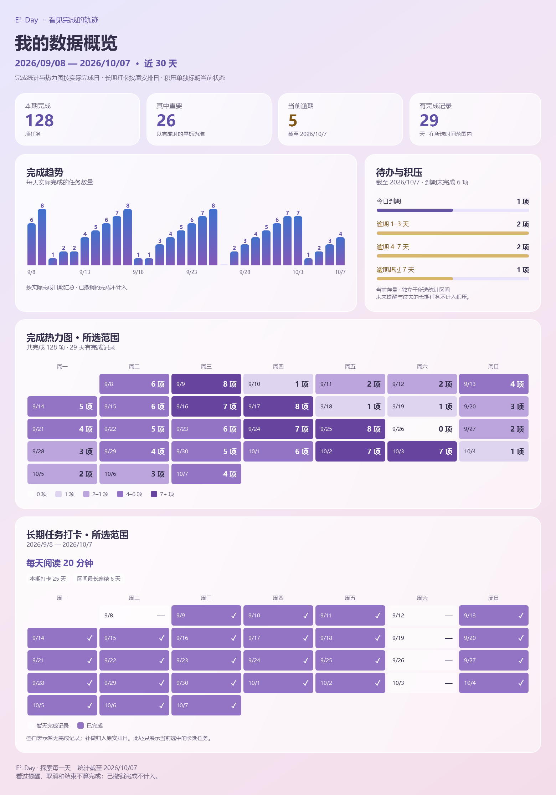

</details>

所有图表均在当前账号本机计算，不生成历史任务，也不将个人统计发往网络。

## 1. 今日清单：记录、执行和回看

在输入框填写标题，按 Enter 或点击“添加”，即可创建今天的任务。右上角“添加任务”可填写标题、备注、日期和重要标记。

**1.0.5 新增备注图片**：编辑任务或事件时，在文字备注下面点击“上传图片”选择多张图片，或点击“粘贴图片”添加剪贴板中的截图。点击“保存”后生效，取消编辑不会改变原备注。

每则备注最多 **8 张**，单张原图不超过 **20 MB**，支持 PNG、JPG、BMP、GIF 和 TIFF；GIF/TIFF 使用第一帧。大图自动缩小到最长边 2048 像素并保存为 PNG。任务卡片、日期详情和历史记录显示缩略图，点击可放大，通过滑块缩放或“适应窗口”查看。

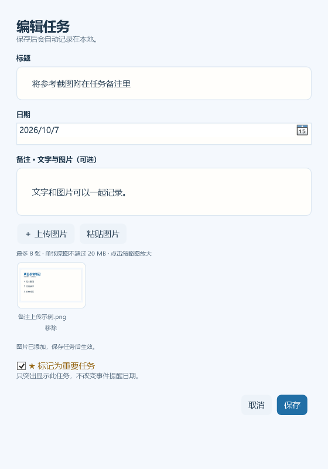

图片保存在本机数据库，移动或删除原始文件后仍可查看。当前备注与历史快照独立保存：完成、查看或取消时记录当时的图片，之后修改或移除当前备注的图片不会覆盖已经保存的历史图片。重复事件按“仅这一次”或“这一次及以后”的编辑范围继承图片。

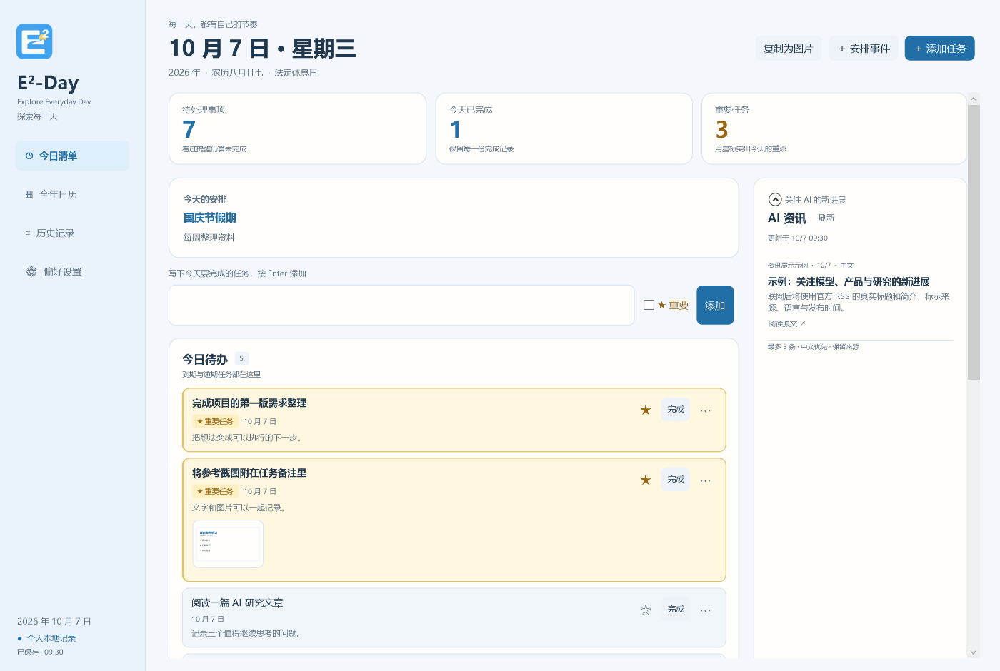


- **重要任务**：点击 `☆` 切换为 `★`，使用金色标签和边框突出显示，并优先排序。重启或恢复备份后仍保留。任务星标只改变显示与排序，不改变事件的提前提醒天数。
- **完成与撤销**：点击“完成”进入淡化、划线的已完成区域，同时记录实际完成日期；点“撤销”恢复未完成状态。
- **逾期延续**：未完成的事情第二天继续显示，原定日期不变。例如 10 月 5 日的任务在 10 月 7 日仍未完成，会显示逾期 2 天。
- **编辑、改期、取消**：点击任务右侧 `⋯` 操作。取消保留记录，在历史页勾选“含已取消”后可以找到并恢复。
- **看过提醒**：日历事件关联的任务有“看过”按钮，点击后移入“今日已查看”，第二天重新提醒。看过不等于完成，不计入完成数量。

## 长期任务：每天继续，手动结束

在“添加任务”中勾选“长期任务 · 每天出现，手动结束”，选择开始日期后保存。现有普通任务也可在编辑窗口转换为长期任务。

点击“今日完成”只完成当天这一项，明天会再次出现；点击“结束”停止后续每天出现。以前未完成的长期任务保留在历史中，今天只显示今天这一项。重要标记和图文备注可延续到后续任务，历史快照与备份继续保留。

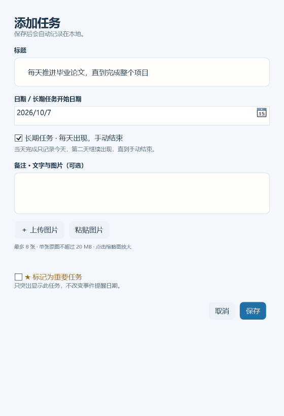

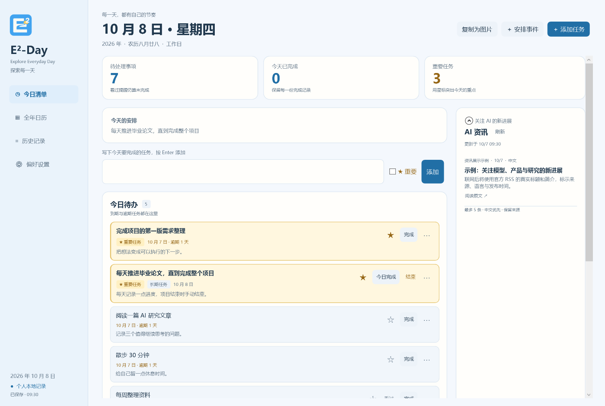

包含长期任务的数据或备份需要 1.0.6 或更新版本读取。既有 1.0.5 及更早的任务、图片和备份继续兼容。

## 2. 全年与月度日历：先安排未来

“全年日历”默认显示 12 个月。点击月份标题进入放大月历，可切换上月、下月、回到本月，或返回全年总览。

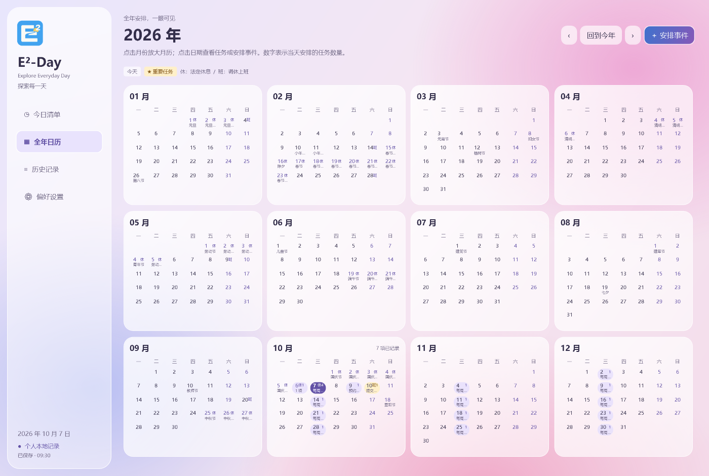

月历在日期下方显示任务标题摘要，包括手动任务、日历事件和未来重复安排。重要任务优先，已完成项带勾选并淡化保留。每天预览前三项，超过时显示“还有 N 项”；悬停查看完整标题，点击日期查看全部，或添加、编辑任务与事件。

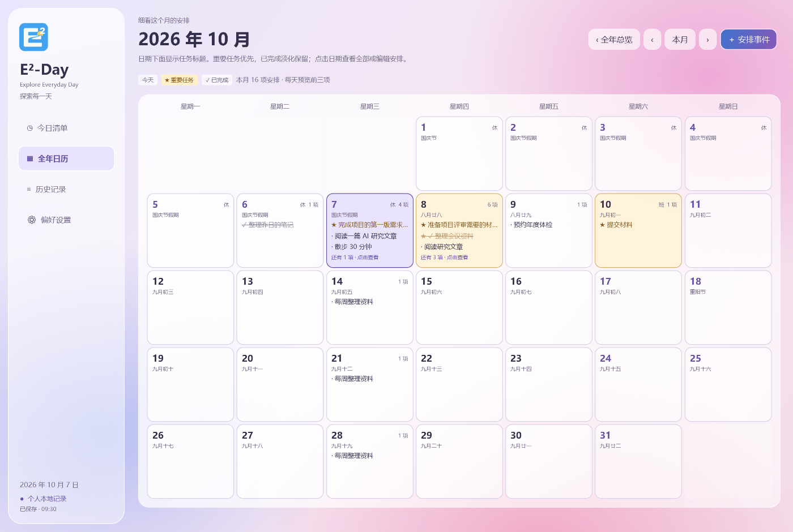

日期同时展示公历、农历、节日，以及已知年度的法定放假和调休上班信息。发布包附带 **2024–2026 年中国大陆放假调休数据**。其它年度可在“偏好设置”联网更新；未获得数据时明确提示“放假调休数据未更新”，不会把普通周末当作已核实的法定假期。

## 3. 日历事件：重复规则与提前提醒

日历事件适合会议、生日、纪念日、周期性整理和提交材料等有日期或重复规则的事情；普通任务适合需要完成的一次性行动。

| 事件等级 | 默认开始提醒时间 | 例子 |
| --- | --- | --- |
| 普通 | 当天，提前 0 天 | 当天例会 |
| 重要 | 提前 3 天 | 需要预先准备的体检或预约 |
| 非常重要 | 提前 7 天 | 生日、纪念日或重要截止日期 |

在“偏好设置”中可把各档提前天数调整为 **0–365 的整数**，按自然日计算。提醒出现在 App 的“提前提醒”或“今日待办”清单中。

支持一次性、每周、每月、每年公历、每年农历五种安排。每次重复分别完成，上一期逾期不会自动被标为完成。修改或取消重复事件时，可选择“仅这一次”或“这一次及以后”。

边界规则：每月 31 日遇到没有 31 日的月份时使用当月最后一天，之后仍按原规则计算；2 月 29 日的年度安排在非闰年使用 2 月最后一天；每年农历重复按普通月份计算，闰月不额外生成一次。农历转换超出支持范围时不会虚构日期。

## 4. 历史记录：完成日期与原定日期分开保存

历史页可选择日期，回看当天事项和完成、查看、取消等操作。输入关键词后搜索所有日期中的标题、备注和保留的历史操作；勾选“含已取消”可查看和恢复取消项。

例如：原计划 10 月 5 日完成的任务，实际在 10 月 7 日完成，则计入 **10 月 7 日的完成数量**；在 10 月 5 日的安排中仍能看到它最终何时完成。任务卡片反映当前状态，历史操作保留当时的标题、备注和原定日期，方便回顾后来修改过的事项。

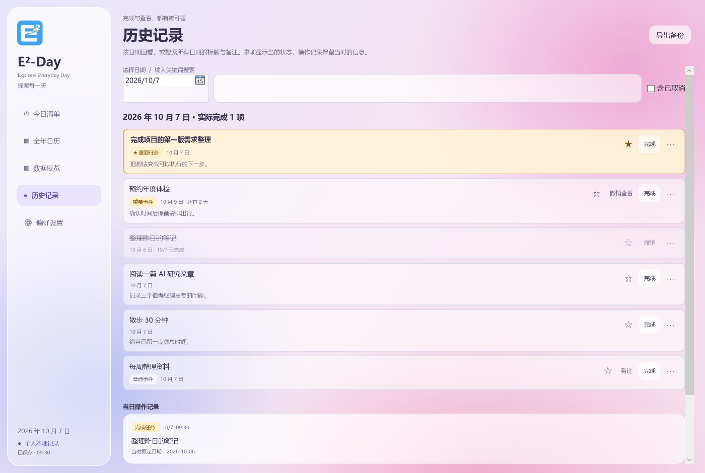

## 5. 数据、自动备份与更新

个人记录默认保存在 `%LOCALAPPDATA%\DailyRecord`，与程序所在文件夹分开。应用使用 SQLite 保存本机记录，操作后自动保存，并通过文件锁避免多个窗口同时覆盖同一份数据。

- 运行当天自动更新一份备份，保留最近 **30 份**；程序关闭期间不执行后台备份。
- 在“偏好设置”或历史页点击“导出备份”，导出 JSON 文件。
- “从备份恢复”先验证结构和 SHA-256 完整性校验，再提示恢复会替换当前记录；恢复前另存一份当前记录的备份。
- 数据与备份保存在本地，**没有云同步，也没有加密存储**。更换电脑时请自行转移导出的备份。
- 备注图片随自动备份、手动导出和恢复前备份一起保存，可在另一电脑独立恢复。1.0.5 兼容读取旧版无图备份；旧含图备份需要 **1.0.5 或更新版本** 读取；2.0 的 E2DayExchange 交换文件需用 **2.0 或更新版本** 读取。新版本保存后的数据库格式也已升级，更新前请保留旧版导出备份，避免直接使用旧程序打开升级后的数据。
- 更新前关闭程序，再完整解压新的程序包。它继续读取原有本地数据目录；更新前建议导出一份备份。

## 6. 今日任务复制为图片

点击“今日清单”右上角“复制为图片”，看到“已复制图片”后，在支持图片粘贴的聊天窗口按 `Ctrl+V`。

分享图包含日期、今日待办、今日已完成、完整任务标题、重要标记和完成状态；逾期任务注明原定日期。长清单自动生成完整长图，不受窗口滚动位置影响。备注、提前提醒和今日已查看不进入图片。图片只复制到剪贴板，由你决定粘贴和分享的位置。

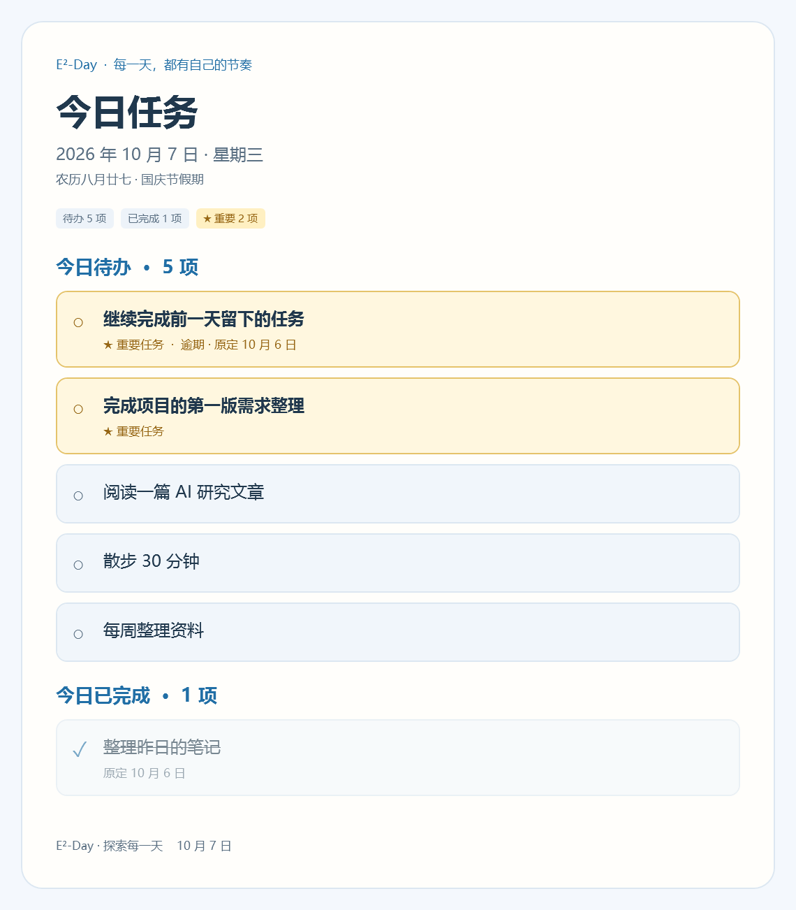

## 7. AI 资讯：阅读公开来源

今日页面右侧从微软、Google、OpenAI、Google DeepMind 和 Microsoft Research 的公开 RSS 获取 AI 相关资讯。展示来源提供的标题、简介、发布时间、语言和原文链接，**最多 5 条，中文优先**，不需要 API 密钥或付费订阅。

资讯按相关关键词和近期发布时间筛选，没有合适内容时可以少于 5 条。网络或来源不可用时保留上次缓存并显示更新时间；任务、日历和历史仍可正常离线使用。程序不抓取文章全文，不提供自动翻译或 AI 对话功能。

## 常见问题

**提醒会弹出系统通知吗？** 当前为 App 内提醒。关闭窗口即退出，不驻留后台，不设置开机启动，也不发送系统通知。

**需要登录或上传个人记录吗？** 2.0 使用各设备自己的本机账号，没有云账号。手机首次联网下载应用资源，之后本机离线记录；需要交换时自己导出、传送文件。电脑版联网读取公开资讯和节假日，不把个人记录发送给这些来源。

**为什么打开程序失败？** 先确认选择了正确架构并完整解压，不能只拷贝一个 EXE；不要同时打开使用同一数据目录的多个实例。仍有问题可在 [Issues](https://github.com/yilaxin/E2-Day/issues) 提供版本、系统架构和报错文字，请勿公开个人任务数据库或备份。

**下载包是安装程序吗？** 是免安装程序包，不是安装向导。EXE 旁边的依赖文件必须一起保留。程序文件夹可以移动，个人记录仍在本机数据目录。

## 源码构建与验证

需要 Windows、**PowerShell 7** 和 **.NET SDK 10**，在项目根目录执行：

```powershell
# 获取依赖并使用项目内缓存
./scripts/Get-Dependencies.ps1
. ./scripts/Environment.ps1
dotnet build src/DailyRecord.App/DailyRecord.App.csproj -m:1 -p:UseSharedCompilation=false

# 核心行为测试与真实 WPF 控件回归
./scripts/Test.ps1

# 另外验证在线 RSS
./scripts/Test.ps1 -Network

# 自包含发布：选择目标架构
./scripts/Publish.ps1 -RuntimeIdentifier win-arm64
./scripts/Publish.ps1 -RuntimeIdentifier win-x64

# 在支持对应架构的 Windows 环境验证发布包
./scripts/Test.ps1 -Published -RuntimeIdentifier win-arm64
./scripts/Test.ps1 -Published -RuntimeIdentifier win-x64
```

构建产物按版本保存在 `artifacts/releases/v<版本>/programs/`，候选 ZIP 在同版本目录；不会覆盖正在使用的旧程序目录。

NuGet 依赖固定版本，依赖与 CLI 缓存放在项目内 `.build`。依赖脚本从 NuGet 官方接口获取所需包，随后使用项目内离线包源还原。测试采用隔离数据目录和固定示例日期，不读取正常个人数据。

| 目录 | 内容 |
| --- | --- |
| `src/DailyRecord.Core` | 任务状态、重复日期、SQLite、备份、节假日和 RSS |
| `src/DailyRecord.App` | WPF 页面、账号、事件编辑、月历、分享图片和界面验证入口 |
| `src/DailyRecord.Mobile` | 独立手机应用、本机存储、离线缓存和文件交换 |
| `tests/mobile-rules.mjs` | 手机日期规则、通用文件校验与连续保存验证 |
| `tests/mobile-file-import.mjs` | 两端合并协议、图片、原子提交与失败保留验证 |
| `tests/mobile-offline-start.mjs` | 缓存导航与本机首屏不等待网络验证 |
| `tests/DailyRecord.Tests` | 核心行为场景测试 |
| `data/holidays` | 2024–2026 年中国放假调休数据及第三方许可证 |
| `scripts` | 依赖获取、测试、两种架构打包和桌面快捷方式工具 |
| `docs/images` | 隔离示例数据生成的功能截图 |

测试细节见 [验证记录](验证记录.md)，版本变化见 [CHANGELOG](CHANGELOG.md)。

## 版权与第三方声明

Copyright © 2026 **yilaxin**。**保留版权，允许免费下载并运行正式发布的 App。** 本仓库公开源码用于了解项目与审阅实现，不采用通用开源许可证；源码修改、再分发或商业销售等用途需另行取得作者许可，详见 [LICENSE](LICENSE)。

第三方运行时、组件、节假日数据和资讯内容仍遵循各自的许可证或权利声明，详见 [THIRD_PARTY_NOTICES.md](THIRD_PARTY_NOTICES.md)。
