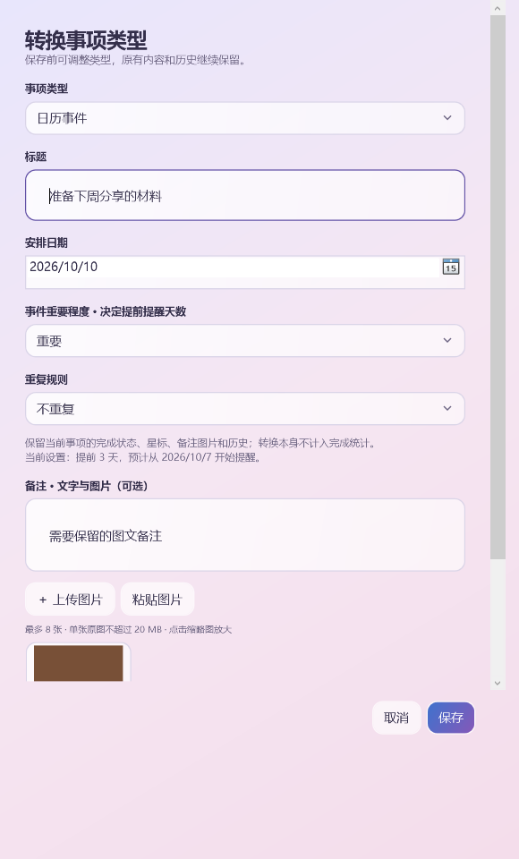

# E²-Day 2.1.12 · 任务、事件与长期任务互相切换

> 2.1.12 为本地更新，功能已并入公开版本 [2.1.13](https://github.com/yilaxin/E2-Day/releases/tag/v2.1.13)，未单独公开 2.1.12 程序包。下方下载链接对应 2.1.13。

提前安排的任务可以直接改成日历事件，已有事件也可以改为普通任务或每天出现的长期任务，原来的图文备注、重要标记与历史继续保留。

- 在事项“更多”中选择转换目标，或在编辑窗口顶部切换“事项类型”；按类型显示日期、提醒等级与重复规则。未保存草稿在三种类型间保留，保存／取消固定在底部，继续使用粉紫玻璃界面。
- 保存前显示提醒开始时间，以及停止原后续安排时受影响的已有待办数。支持仅转换本次，或同时停止原后续安排；已完成记录保留，转换实例不会被旧规则重新生成。
- 原位保留事项身份、创建时间、原定日期、备注原图、完成日期和历史。已完成仍为已完成，已归档仍为归档；转换本身不增加完成次数。
- 长期任务已有打卡保留原归属；已完成普通任务转为长期任务不补算历史打卡。保留原规则同时建立新重复规则时，两套安排独立继续；整体改类型请选停止原后续安排。

## 下载与更新

| Windows 架构 | 自包含免安装包 |
| --- | --- |
| Intel / AMD x64 | [E2-Day-v2.1.13-win-x64.zip](https://github.com/yilaxin/E2-Day/releases/download/v2.1.13/E2-Day-v2.1.13-win-x64.zip) |
| Windows ARM64 | [E2-Day-v2.1.13-win-arm64.zip](https://github.com/yilaxin/E2-Day/releases/download/v2.1.13/E2-Day-v2.1.13-win-arm64.zip) |

完整解压到新文件夹运行 DailyRecord.exe，保留 DLL、Data、Mobile 和图标。旧账号与备份可继续读取；转换操作支持本版备份及交换。包未做数字签名，提供 SHA256SUMS.txt；保留历史发布和原版权许可。

类型转换首先提供在 Windows。交换已转换的记录请使用 Windows 2.1.12 或更新后的网页手机版；网页保留转换来源、完成归属及图片，支持当前任务编辑、完成／撤销和导出。旧 Windows 或鸿蒙原生客户端尚未验证新增字段完整往返，可能丢失转换或打卡归属，跨旧客户端前请保留本版备份。家教版保持 1.2.0，鸿蒙原生公开版保持 0.1.1。

## 验证

79 项核心规则和手机规则、文件交换、离线启动通过。ARM64／x64 正式程序执行实际模态编辑、快捷菜单、保存／取消、提醒、图片、打卡及历史验证，并回归日历、平滑滚动、页面资源回收、分享与实际启动。检查版本 2.1.12.0、PE 架构、包内必要文件和 SHA-256，公开下载复核归于后续 2.1.13 发布。x64 在 ARM64 主机兼容环境验证。测试及截图仅使用隔离示例，不替换系统剪贴板，不上传个人数据。