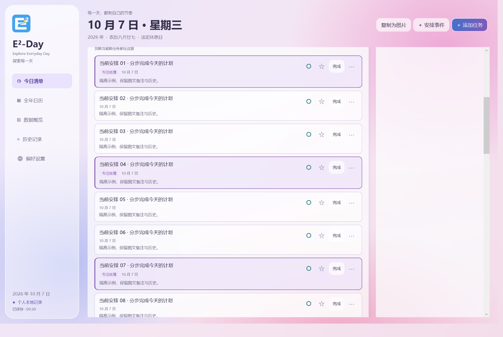

# E²-Day 2.1.14 · 任务行一键着色

星标旁新增快捷颜色圆点，挑选当前准备做的任务只需各点一次。

- 左键立即加入快捷颜色，再点恢复此前实际颜色；已有快捷色且没有恢复记录时取消为未分类。空／实心圆与悬停说明当前操作，金色重要星标独立保留。
- 右键第一层直接选择五色和未分类，重复事件及长期任务默认只改这一次。今日分类区与偏好设置可选择快捷色，按账号保存。
- 保存恢复颜色与单次覆盖状态，重启和含图备份恢复后仍可使用；显式选色或事项类型转换结束旧临时恢复关系。
- 着色后保留当前滚动位置，列表缩短时停在新的边界；后续输入优先，旧缓动不拖动页面。提供约六秒的分类提示和撤销，筛选移出任务也可找回。
- 延续粉紫玻璃风格、平滑滚动、原图备注、任务类型转换、长期打卡、颜色筛选、批量、分类图片分享与历史。

## 下载与更新

| Windows 架构 | 自包含免安装包 |
| --- | --- |
| Intel / AMD x64 | [E2-Day-v2.1.14-win-x64.zip](https://github.com/yilaxin/E2-Day/releases/download/v2.1.14/E2-Day-v2.1.14-win-x64.zip) |
| Windows ARM64 | [E2-Day-v2.1.14-win-arm64.zip](https://github.com/yilaxin/E2-Day/releases/download/v2.1.14/E2-Day-v2.1.14-win-arm64.zip) |

完整解压后运行 DailyRecord.exe，保留 DLL、Data、Mobile 及图标。旧账号与备份可继续读取。包未做数字签名，附 SHA256SUMS.txt，原版权许可及历史版本保留。家教版仍为 1.2.0，鸿蒙公开版仍为 0.1.1。

恢复为上一实际颜色，不叠加多层恢复；右键／批量等显式设置会清除原临时恢复关系。若期间重复规则默认色变化，恢复色保留为本次分类。网页文件资源保留新增字段，没有快捷操作界面；旧客户端可能丢失恢复信息，跨旧客户端前保留本版备份。文件合并沿用接收账号自己的偏好。

## 验证

92 项核心规则、手机规则／文件交换／离线启动及两架构正式 WPF／实际启动入口验证通过。涵盖真实菜单、恢复、撤销、筛选移出、账号设置、今日／历史视口、连续滚动期间着色、重复任务仅本次与关闭清理，并回归资源回收、日历、图片、统计分享及开场。x64 在 ARM64 主机兼容环境执行。

检查 2.1.14.0、架构、包内容和 SHA-256，公开后下载完整程序包复核。所有示例隔离，不写系统剪贴板；个人数据、真实图片、备份、日志、凭据和构建缓存不上传。