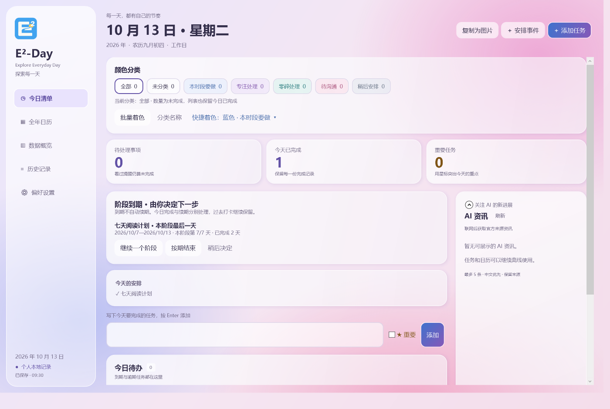

# E²-Day 2.1.15 · 长期任务阶段与清爽日历

长期任务按阶段安排，到期由你决定是否继续；日历可以随时恢复清爽。

- 长期任务默认 30 天，可选 7 天、自定义 1～3650 天、结束日期或持续进行，保存前显示含首日的起止日期。已有无限任务保持原安排。
- 最后一天完成后仍可续期，支持按期结束与稍后决定；错过到期暂停待决定，不自动补出空档任务。续期沿用同一长期任务和累计打卡，默认次日衔接或过期从今天开始，也可选择未来日期。
- 显示本阶段第 X／Y 天与实际完成天数，保留备注原图、颜色、星标、历史和备份。期限缩短只归档未来未完成实例，保留已完成记录。
- 年历和月历提供全部安排、隐藏长期任务及纯日历。一键进入纯日历，再点恢复先前视图；按账号保存，复用日期控件并保留年份、月份和滚动。点击日期仍查看完整事项，不影响清单和提醒。

## 下载与更新

| Windows 架构 | 自包含免安装包 |
| --- | --- |
| Intel / AMD x64 | [E2-Day-v2.1.15-win-x64.zip](https://github.com/yilaxin/E2-Day/releases/download/v2.1.15/E2-Day-v2.1.15-win-x64.zip) |
| Windows ARM64 | [E2-Day-v2.1.15-win-arm64.zip](https://github.com/yilaxin/E2-Day/releases/download/v2.1.15/E2-Day-v2.1.15-win-arm64.zip) |

完整解压后运行 DailyRecord.exe，保留 DLL、Data、Mobile 和图标。旧账号、历史和备份可继续使用。程序未做数字签名，附 SHA256SUMS.txt，原版权许可与历史发布保留。家教版仍为 1.2.0，鸿蒙公开版仍为 0.1.1。

“按期结束”保留今天，“结束”仍为立即停止。阶段日期与空档随本版备份保存，更新后的网页资源保留阶段并遵循日期范围，但无新管理入口；手动文件合并保留接收账号的显示偏好。旧客户端可能丢失阶段字段，跨旧客户端前保留本版备份。

## 验证

102 项核心规则、网页规则／文件交换／离线启动以及两架构正式 WPF／实际启动验证通过，覆盖日期边界、续期和取消、阶段进度、过期处理、三视图、日期控件复用与滚动位置，并回归颜色、图片、统计分享、资源回收及开场。x64 在 ARM64 主机兼容环境执行。

检查 2.1.15.0、架构、必要文件和 SHA-256，公开后下载完整程序包复核。全部示例数据隔离；个人数据库、真实图片、备份、日志、凭据和缓存不上传。