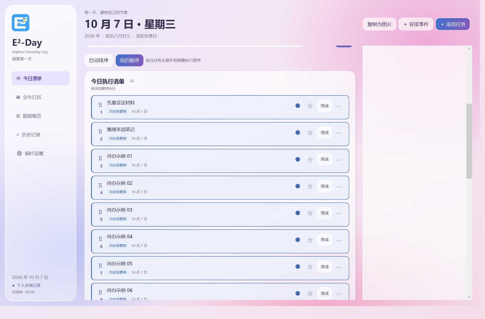

# E²-Day 2.1.16 · 今日执行顺序

按住今日清单任务左侧的手柄即可调整执行顺序。清单会在拖动时标出落点，靠近上下边缘时自动滚动。第一次移动会切换到「我的顺序」，合并未完成的待办、提前提醒和已查看事项，并显示执行序号。切回「自动排序」即可按原分组浏览。

- 新任务和新出现的提醒追加在末尾。完成后任务移入已完成区域，当天撤销完成会回到原来的位置。跨天时，仍可见的任务保留相对顺序，新一天的长期任务实例排在后面。
- 按颜色筛选后，拖动和菜单调整只交换可见任务所占的位置。任务「更多 → 调整执行顺序」提供移到最前、上移、下移和移到最后。每次移动自动保存，短暂显示撤销入口。
- 复制图片沿用屏幕的筛选和顺序。「我的顺序」会显示序号，「自动排序」也包含屏幕上的提前提醒和已查看任务。
- 排序按账号保存，备份可恢复。文件交换沿用接收账号的显示偏好，网页可保留排序数据，但拖动操作在 Windows 端提供。

## 下载安装

| Windows 架构 | 自包含程序包 |
| --- | --- |
| Intel／AMD x64 | [下载 x64](https://github.com/yilaxin/E2-Day/releases/download/v2.1.16/E2-Day-v2.1.16-win-x64.zip) |
| ARM64 | [下载 ARM64](https://github.com/yilaxin/E2-Day/releases/download/v2.1.16/E2-Day-v2.1.16-win-arm64.zip) |

完整解压后运行 DailyRecord.exe。发布附 SHA256SUMS.txt，使用原版权许可。

## 验证

106 项核心测试覆盖排序模式、可见位置、撤销、跨天、重启和备份。网页交换与离线启动，以及 ARM64／x64 的界面和实际启动均通过验证。隔离样例用于界面和截图。
