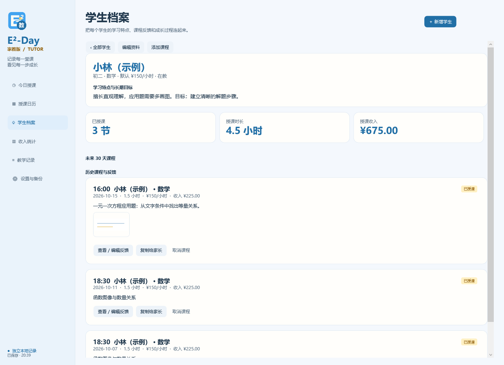
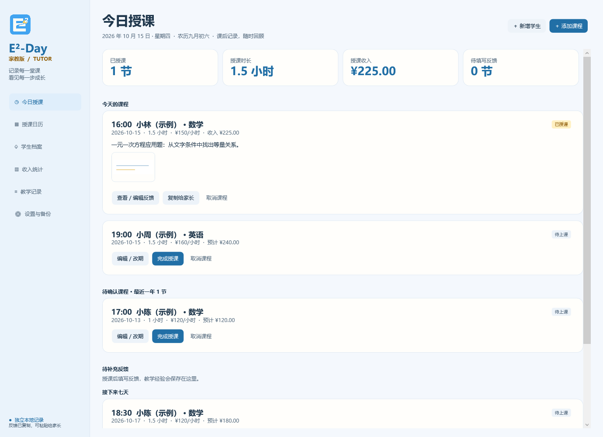
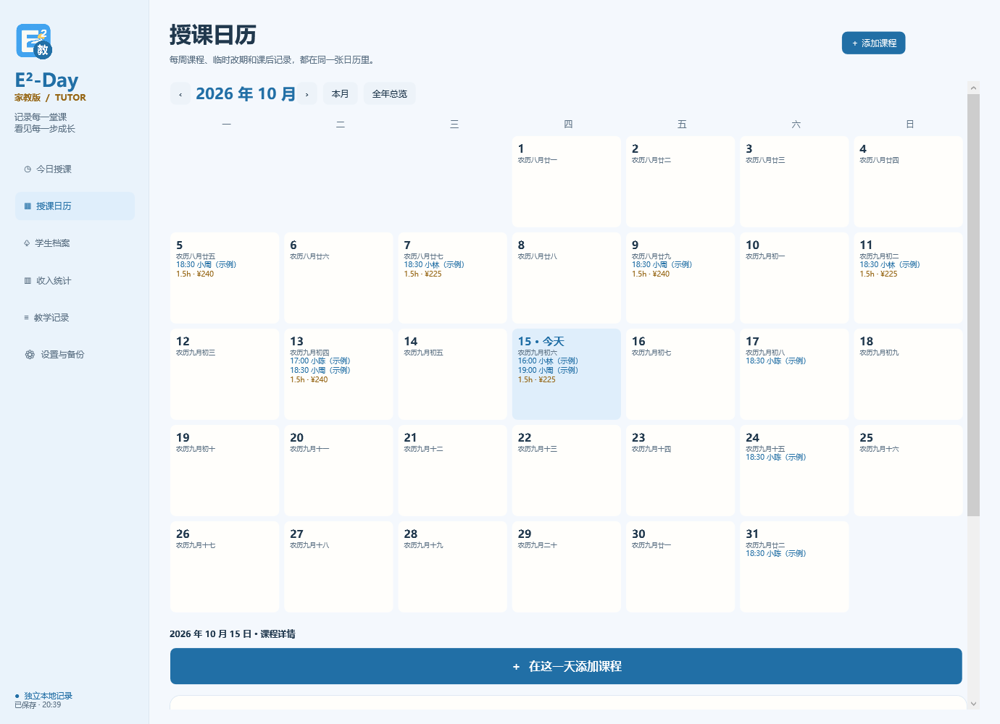
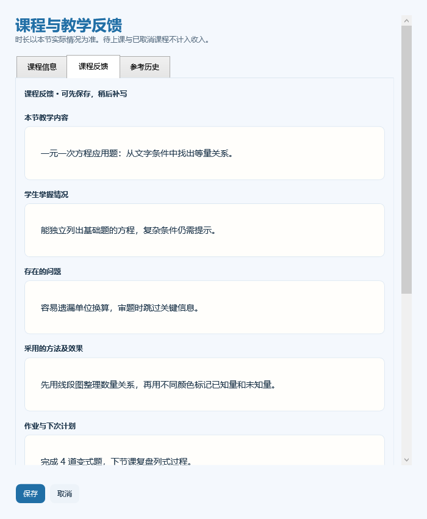

# E²-Day 家教版使用说明

当前版本 **1.0.1**。面向一对一家教老师，记录学生、课程、课后反馈与授课收入。仅支持 Windows 64 位电脑，提供 x64 和 ARM64 自包含免安装程序包。

## 下载与打开

发布页：[家教版 1.0.1](https://github.com/yilaxin/E2-Day/releases/tag/tutor-v1.0.1)。Intel / AMD 电脑下载 `win-x64.zip`，Snapdragon 等 ARM 电脑下载 `win-arm64.zip`。完整解压后双击 **E2Day.Tutor.exe**，保留旁边的依赖文件和 Data 文件夹；无需另装 .NET。

家教版使用带“教”字的图标。可对 exe 右键创建桌面快捷方式，命名为“E²-Day 家教版”。日常版程序仍为 DailyRecord.exe，两者可同时打开。

## 本机账号与独立数据

首次打开创建本机账号，密码 8–128 个字符，并保存离线恢复码。可以记住本机登录；在“设置与备份”切换账号。忘记密码时在登录窗口选择“使用离线恢复码”。每个账号独立保存记录，没有云端账号。

家教版数据根目录为 `%LOCALAPPDATA%\E2DayTutor`，账号记录在 `Accounts/<账号标识>/tutor.db`；日常版仍使用 `%LOCALAPPDATA%\DailyRecord`。家教版不会读取或迁移日常版记录。数据库和导出备份没有加密，请妥善保管。

首次使用为空白，文档截图均来自隔离示例数据。

## 1. 新增学生

在“学生档案”或首页点击“新增学生”，填写姓名或昵称、年级、默认科目、默认时薪、学习特点与长期目标。默认时薪可为零，最高 1000000 元/小时。

学生结束辅导后可以勾选“已结课”，历史课程、反馈与收入保留。新建课程默认选择在教学生，旧课程仍可编辑。归档不自动取消既有排课，需要时在日历中停止后续课程。



## 2. 排课与补录

点击“添加课程”，在“课程信息”中选择学生、科目、日期、开始时间、时长、时薪和状态。时长以小时填写，例如 1.5，须能换算为整数分钟，范围 1–1440 分钟。

- **待上课**：仅作为计划，展示预计金额，不计入收入。
- **已授课**：按实际时长与本节时薪计入收入；可以补录以前的课程。
- **已取消**：保留记录，不计入收入。需要恢复时编辑状态。

每节课收入 = 分钟数 × 时薪 ÷ 60，按每节课四舍五入至分。汇总累加各节课金额。每节课独立保存时薪；修改学生默认时薪不会覆盖旧课，也不会自动更改既有重复排课的价格。

收入按填写的授课日期归属。例如 10 月 12 日补录 9 月 30 日的课，收入归到 9 月 30 日。确认授课时请检查实际日期、时长和时薪。



## 3. 每周重复、改期和停课

新增待上课程时勾选“每周同一天、同一时间重复排课”。后续课程按日历预测，无需提前批量生成记录。图片请在保存排课后，单独编辑本次添加。

编辑重复课程可以选择“仅修改这一次”或“修改这一次及以后”。单次改期沿用同一课程身份，原定日期不会留下重复课程；批量调整更新后续排课信息，保留已经确认授课与取消的记录。调整重复规则的起始日期不能早于本次原定日期。

停止后续课程：编辑一节待上的重复课，选择“这一次及以后”，将状态改为“已取消”并保存。停止后不再预测未来课程，已经授课与取消的记录保留。课程反馈、图片请按单次课程编辑。

过期未确认课程在首页显示最近一年内的待确认摘要；“教学记录 → 待确认课程”可查看更早的全部待确认课程。它们不会自动挪到今天，也不会自动计费。

## 4. 授课日历

默认显示月历，日期格子显示课程开始时间与学生摘要，并汇总当天已授课时长与收入。点击日期查看课程详情并添加课程；“全年总览”可查看各月已授课汇总并进入该月。

日期详情中的“在这一天添加课程”使用蓝底白字的大按钮，点击后直接为当前所选日期录课。


保留 Eday 的农历和已打包节假日信息；未知年度不猜测法定放假与调休。课程日期与统计支持 1901–2100 年。



## 5. 反馈、图片与教学经验

完成授课时可以先保存课程，稍后从“待补充反馈”进入。“课程反馈”分为教学内容、掌握情况、存在问题、教学方法及效果、作业与下次计划，以及自己的内部备注。

图片支持上传和粘贴，最多 8 张，单张原图不超过 20 MB；大图缩小至最长边 2048 像素并保存为 PNG。点击缩略图可放大。图片存在数据库中，不依赖原文件；编辑窗口取消时不改变已保存记录。图片随备份保存。

“复制给家长”复制课程反馈文字，包含学生、科目和授课日期，不含收入、内部备注和图片。图片由老师单独选择是否分享。不会自动发送消息。

“参考历史”可按课程内容、问题或方法搜索已授课记录，只引用教学内容、方法与下次计划；当前学生的掌握情况和问题由老师自行填写。引用前如有内容会提示替换，旧课程不会改变。

“教学记录”支持关键词、学生和状态筛选，搜索包括内部备注。默认显示已保存的单次课程与记录；未来重复安排从日历查看，过去未确认的重复课通过“待确认课程”查看。



## 6. 收入统计

支持今天、本周至今、本月至今、今年至今、自选日期范围与学生筛选，展示已授课次数、课时、授课收入、学生明细与趋势。短时间范围按日展示，超过 62 天按月展示。学生档案同时展示累计已授课汇总。

授课收入表示已上课程产生的金额，**不等于已经收款**。本版不记录到账、欠费、预付课包或退款。


## 7. 备课待办与备份

首页的“备课与其他待办”可记录准备练习、整理资料等事项，支持完成、撤销和移除。

操作后自动保存；运行当天自动更新一份备份，保留最近 30 份。关闭应用期间不执行后台备份。自动备份失败会显示提示，已成功保存的课程仍保留。

“设置与备份 → 导出家教版备份”导出完整 JSON，含学生、课程、重复规则、反馈、图片与待办。换电脑时安装家教版、创建本机账号，再恢复备份；账号密码和恢复码不包含在教学备份中。

恢复先验证家教版格式、版本、SHA-256 与图片，展示学生与课程记录数量；确认后替换当前账号记录，并先保存当前记录的恢复前备份。无效文件不改变现有记录。此备份与日常版、手机交换文件互不兼容。

## 当前范围与版权

第一版仅做一对一 Windows 桌面授课记录。没有手机同步、云同步、系统通知、多人班课、课包核销或实际收款管理。程序未作数字签名；发布页提供 SHA256SUMS.txt。

保留版权，允许下载和运行正式发布程序；不采用 MIT 等通用开源许可。详见包内 LICENSE 与 THIRD_PARTY_NOTICES.md。

## 源码构建与验证

需要 Windows、PowerShell 7 和 .NET SDK 10。

```powershell
./scripts/Get-Dependencies.ps1
. ./scripts/Environment.ps1
./scripts/Test-Tutor.ps1
./scripts/Publish.ps1 -Edition Tutor -RuntimeIdentifier win-arm64
./scripts/Publish.ps1 -Edition Tutor -RuntimeIdentifier win-x64
./scripts/Test-Tutor.ps1 -Published -RuntimeIdentifier win-arm64
./scripts/Test-Tutor.ps1 -Published -RuntimeIdentifier win-x64
./scripts/Prepare-Release.ps1 -Edition Tutor
./scripts/Publish-GitHub.ps1 -Edition Tutor
```

程序包位于 `artifacts/releases/tutor-v1.0.1`，发布标签为 `tutor-v1.0.1`，普通版仍使用原来的版本与标签。家教版发布不会替换仓库“最新版”的日常版入口。
