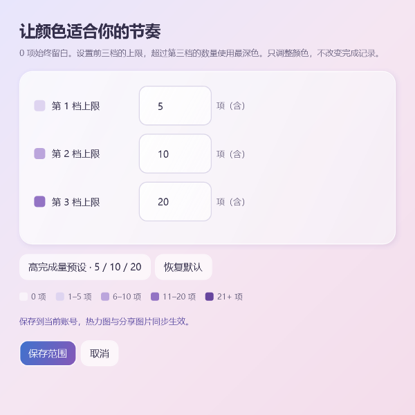

# E²-Day

## 家教版独立入口

家教版 1.1.1 新增“教学概览”，集中查看授课热力日历、课程执行、学生课时分布、反馈跟进与当前学习需求。支持日期与学生筛选，并从图表跳转到课程或学生档案；学生学校、授课地点和学习标签继续保留。

家教版新用户可先阅读[下载、首次启动与使用 PDF 教程](docs/E2-Day-Tutor-Guide.pdf)，解压后的程序包内也附带这份教程。

如需记录学生、课程、课后反馈与授课收入，请下载独立的 [E²-Day 家教版](https://github.com/yilaxin/E2-Day/releases/tag/tutor-v1.1.1)，阅读[家教版使用说明](docs/TUTOR-GUIDE.md)。程序为 E2Day.Tutor.exe，数据保存在 E2DayTutor 目录，与日常版分别运行。本文件下方为日常版说明。

先体验再录入：在空白首页、空白教学概览或「设置与备份」点击 **“体验示例数据”**。独立窗口中有 6 位虚构学生、近三个月课程、收入、反馈与每周排课，可自由试用，关闭后丢弃本次修改，再次进入按当天重新生成。真实账号及备份保持原样。

Explore Everyday Day · 探索每一天。

Windows 桌面应用与手机主屏幕应用：全年安排、每日任务、提前提醒与完成记录。本文对应 Windows 2.1.11 和鸿蒙原生版 0.1.1；华为 Pura 70 已验证原生安装、离线保存和两端含图文件交换，网页手机入口继续可用，iPhone 尚未真机验证。

鸿蒙原生版桌面名称为 **E²-Day**。已安装的自用调试版可独立离线使用；GitHub 只提供未签名原生构建，其他用户须用自己的开发者账号签名，详见[鸿蒙原生版说明](docs/HARMONY-NATIVE.md)。原生版与旧网页应用各自保存记录，迁移前先导出交换文件，保留原入口和记录。

Windows 界面采用粉紫柔光背景、半透明圆角卡片和蓝紫操作按钮，与 logo 保持协调。金色突出重要任务；已完成任务保留淡化和划线。

## 开始使用

1. 如果拿到的是压缩包，先完整解压到一个固定文件夹。
2. 根据系统类型选择 x64（Intel/AMD）或 ARM64（如部分 Snapdragon 电脑）发布包。双击已有的 `E²-Day` 快捷方式，或文件夹中的 `DailyRecord.exe`。程序包已包含运行依赖，无需单独安装 .NET。
3. 2.0 首次打开先创建账号和密码，保存生成的离线恢复码。已有旧版记录会先自动备份，再迁移到第一个账号；其他新账号从空白清单开始。预览图中的示例内容不会写入个人数据。

程序采用文件夹发布，exe 旁边的 dll、Data 等文件请一起保留。

## 开场动画（Windows 2.1.10）

每次重新启动 App，先打开正常大小的主窗口，在窗口内播放约 3.2 秒的“向着朝阳出发”：天空蓝底板、弯道、金色太阳与 E² 逐渐汇合，随后在同一个窗口进入登录页或已记住账号的今日清单，窗口大小和位置保持连续；动画期间调整尺寸或最大化后也会保留。默认静音。

从第一帧开始，单击动画窗口任意位置即可立即跳过；触屏点击和 Esc、Enter、空格同样可用。跳过动作会被开场窗口接收，不会触发后面页面的按钮。账号读取与动画同时进行；如果读取尚未完成，显示静态 logo 和“正在打开…”。

系统关闭客户端区域动画时，以约 0.2 秒静态品牌画面替代动效。页面切换、恢复最小化窗口不重复播放。动画完成、跳过或关闭后停止计时器；正常任务、登录与原有记录继续沿用。家教版与手机端保持原版本。

官方公开下载：[GitHub Releases](https://github.com/yilaxin/E2-Day/releases/latest)。发布包为免安装压缩包，未做数字签名；2.0 包含手机主屏幕应用，没有 macOS、Linux 或 32 位 Windows 程序包。

## Windows 玻璃拟态界面（2.1.1）

打开桌面 E²-Day 即可使用新界面，无需额外设置。背景为粉紫柔和渐变，侧边导航与内容卡片使用半透明白色，添加、保存等主要操作使用蓝紫渐变。今日清单、全年日历、点击月份后的放大月历、历史与设置保持原有入口。

重要任务仍以金色星标、暖金底色和边框区分；完成后淡化保留，仍可撤销。日期、节日、提前提醒、长期任务、备注图片与复制今日清单图片的操作不变。更新程序继续使用原有本机数据目录；首次预览截图均来自隔离示例数据。家教版自 1.0.4 起同步此主题与页面顺滑滚动；手机版界面保持独立。

## 数据概览（2.1.2）

在左侧选择“数据概览”，无需额外录入数据。近 7 天、近 30 天、本月和今年切换顶部完成数字与完成趋势；今年按月汇总，其余范围按日展示。当前逾期始终表示当前已到期的未完成任务，不受顶部时间范围影响。

- **完成热力图**：按实际完成日汇总全年，默认颜色分为 0、1、2–3、4–6 和 7 项以上，可点“颜色范围”自行调整；可翻阅 1901–2100 年或点“今年”返回，未来日期淡化，点击已过去的日期回看事项。
- **完成趋势**：点击柱形打开对应日或月的完成事项。一个任务只按当前有效的完成状态统计一次，撤销后移除；查看、取消和结束操作不算完成。
- **待办与积压**：分为今日到期、逾期 1–3 天、4–7 天和超过 7 天。点击分组处理任务，完成或改期后重新统计。未来提醒和过去的长期任务不计入积压；看过提醒仍为未完成。
- **长期任务打卡**：用选择器切换长期任务，包含已结束和尚未开始的任务；按月翻阅，点“本月”返回。当天有待完成任务时可点击今天的格子，选择“今日完成”；点击已完成格可回看或撤销。过去空白不自动补建任务。

长期打卡按原安排日期记录，同一个安排日只记一天；补做的实际完成数量仍计入点击完成的那天。本月完成天数截至今天，提前完成未来任务时会显示标记，但不会提前增长截至今天的连续天数。今天尚未完成时，当前连续从昨天续算；最长连续按全部已有完成记录计算。已结束任务的当前连续为零，历史和最长连续保留。空白只表示没有完成记录，不展示无法还原的打卡率或专注时长。

“其中重要”优先使用完成时的星标快照，旧记录无快照时使用当前星标。详情显示事项当前内容与状态；历史中的操作快照仍保留当时内容。所有统计仅来自当前账号的本机数据，不需要联网；导入、恢复备份、重新打开页面或跨天后会读取当前记录。

## 自定义热力图颜色范围（2.1.8）

在“数据概览”的“完成热力图”右上角点击 **颜色范围**。分别填写前三档的完成数量上限，必须是 1–9999 的整数且严格递增。上限包含在本档内，下一档自动从前一档上限加 1 开始，0 项始终留白。

如果每天经常超过 7 项，可点 **高完成量预设 · 5 / 10 / 20**，得到 **0、1–5、6–10、11–20、21+ 项** 五种颜色；也可自行改为 10 / 20 / 30 等范围。填写时下方实时预览图例；点 **保存范围** 才生效，点“取消”或关闭窗口不保存本次修改。**恢复默认** 会填入 1 / 3 / 6，仍需保存确认。

设置保存在当前账号，重启后保留，导出及恢复备份会一并保留；旧数据默认使用原来的 1 / 3 / 6 档位。全年完成热力图和“复制为图片”中的所选区间热力图同步使用该设置。调整范围只影响颜色，不改变记录、完成总数、时间筛选或长期任务打卡的完成标记。

## 隐藏页面与旧内容回收（2.1.11）

全年／月历最近访问的布局仍会短时保留，快速返回时复用原日期控件；离开约 45 秒后，在空闲时自动释放控件、任务预览和引用，下一次进入按当前记录重建。清理遇到平滑滚动或鼠标拖动会延后，交互结束后继续；正在使用的页面不会清理，其他页面刷新也不会延长旧日历的保留期限。

切页、刷新及历史搜索／日期筛选会拆离旧内容和图片来源，避免一个残留输入控件连带保留整页。今日未提交的输入草稿先保存，账号、任务、图片、完成状态、筛选和备份保持原规则，关闭窗口时清除视图并停止回调。

仍使用原硬件加速、粉紫玻璃背景和滚轮缓动。控件释放后由运行时正常回收，任务管理器的总内存不保证立即下降；运行时及图形后端仍有固定或缓存开销。本次重点是限制隐藏控件长期驻留，不能把控件对象的减少等同于总内存的大幅下降。完整样例、阶段数据及连续滚动对照见 docs/MEMORY-v2.1.11.md。

## 内存优化（2.1.7）

今日清单和历史中的备注图片使用小尺寸缩略图，同一张图片在多个事项／历史记录间复用。点击图片时再读取原图，原图质量和备份格式保持不变。无需额外设置。

缩略图缓存在当前窗口／账号内使用，最多 64 项且缓存的像素预算不超过 4 MiB；数据变更会失效，关闭窗口时清空。此限制只针对缓存，不是整个 App 的内存上限，页面正在显示的内容和 Windows／WPF 运行资源仍需内存。

玻璃卡片采用更轻的柔影绘制，保留粉紫背景、半透明圆角和页面布局。各页平滑滚动及全年／月历缓存继续可用。实际内存随数据量、图片、窗口大小和运行时缓存变化；隔离样例对照见 docs/MEMORY-v2.1.7.md。

## 主要页面统一平滑滚动（2.1.6）

今日清单、全年总览、放大月历、历史记录和数据概览均使用相同的平滑滚轮效果：连续输入连贯移动，反向立即响应，停下后自然收住。可直接在任务行、日历日期格、今日快速输入框和历史搜索框上滚动页面，输入内容会保留。

点击任务操作、拖动滚动条、键盘定位、切换页面或月份、历史搜索和日期筛选时，会停止剩余动画。全年／月历继续复用缓存控件；日期弹窗内滚动不会带动背景页面，点击日期仍正常筛选。

滚动遵循 Windows 的滚动行数或整页设置；系统关闭客户端区域动画时使用原生直接滚动。设置页与独立编辑窗口保持原有滚动方式，界面配色和布局保持原样。

## 数据概览平滑滚动（2.1.5）

在数据概览连续滚动滚轮，页面会连贯移动，不再每一格直接跳转。连续输入合并到同一目标，反向滚动立即响应，停下后迅速收住。细小滚轮增量按比例移动；仍使用 Windows 设置的滚动行数或整页距离。

点击控件、拖动滚动条、使用键盘定位、切换页面或刷新图表时，会停止剩余动画，避免继续拉动位置。展开的长期任务菜单仍正常滚动选项，收起后滚动整页。若 Windows 关闭了客户端区域动画，页面自动采用直接滚动。自 2.1.6 起，同样的效果也用于今日清单、全年／月历和历史记录。

## 数据概览滚动（2.1.4）

鼠标停在图表、完成热力图日期格子或收起的长期任务选择框上，滚轮均可上下滚动整个页面。选择框收起时滚动不会切换任务；点击展开后，滚轮用于滚动选项列表，点击选项切换任务。热力图宽度不足时仍可通过底部横向滚动条查看日期。

## 复制数据概览为图片（2.1.3）

1. 打开“数据概览”，选择顶部的近 7 天、近 30 天、本月或今年。
2. 如需分享某个长期任务的打卡，先在长期任务选择器中选好。图片会带上该任务名称。
3. 点击右上角“复制为图片”，看到“✓ 已复制图片”后，在聊天窗口按 Ctrl+V 粘贴。

分享图包含完整统计数字、完成趋势、所选范围的热力图、当前积压和所选长期任务打卡，保持粉紫玻璃风格。图片独立排版，底部内容会完整导出，无需调整窗口或滚动到特定位置。

图片以顶部所选时间范围为准，不受屏幕单独翻阅的热力图年份或打卡月份影响。完成趋势／热力图按实际完成日，长期打卡按原安排日；打卡展示“本期打卡”和“区间最长连续”。积压是复制时当前未完成状态，并单独标明截至日期，不代表区间内的历史积压。

分享图会包含当前选中的长期任务名称与打卡，其他任务仅汇总数量，不包含任务清单、备注文字、备注图片、账号名和本机路径。没有长期任务时显示空状态。图片先在本机生成，再写入剪贴板；不会自动发送或上传给别人，也不会改写任务、备份或筛选状态。剪贴板短暂占用时会自动重试。

## 本机账号

- 账号名 2 至 40 个字符，密码 8 至 128 个字符。各设备在本机创建，不需要邮箱或手机号。
- 电脑在“偏好设置 → 本机账号”锁定或切换，手机在“账号”页锁定或切换。默认记住已登录账号，下次直接打开。
- 电脑与手机使用各自账号，同名账号也不会联网关联。交换文件只带记录和图片，不包含账号密码与恢复码。
- 保存创建时的离线恢复码。已登录时可修改本机密码；忘记密码可用恢复码恢复访问。密码修改仅影响当前设备。恢复码不能找回已经删除的记录。
- 数据库、手机本地记录和交换文件没有磁盘加密。账号密码用于应用登录，电脑记住登录的令牌由 Windows 当前用户保护，密码保存为加盐校验值。

## 鸿蒙原生版使用

从手机桌面打开已安装的 **E²-Day**，创建本机账号并保存恢复码。在“今日 → 记一件事”新增任务，填写日期、备注和图片；点任务左侧圆圈完成，再点一次撤销，星标切换重要。“账号”中可导出／导入交换文件、查看导入前副本、查看已取消任务及切换账号。记录保存在本机，断网、关闭重开或修改后重开仍保留。

当前手机编辑器新建普通任务，导入的重复事件继续生成任务。导入采用整条版本选择，保留双方独有记录。签名有设备范围和有效期，更新前先导出备份，保留包名及兼容签名后覆盖安装，不先卸载。原生 APK 不适用于此工程，使用鸿蒙 HAP；完整构建与签名步骤见原生说明。

## 网页手机应用独立安装

1. 用手机浏览器打开 [E²-Day 手机应用](https://yilaxin.github.io/E2-Day/mobile/)。第一次需要联网下载应用资源。
2. 创建手机本机账号和密码，保存离线恢复码。
3. 在“账号 → 离线使用”确认显示“离线入口已准备好”。
4. 在浏览器菜单选择“添加至桌面”“添加到主屏幕”或“安装应用”。华为浏览器通常在“添加至”里选择“桌面”；菜单文字可能随版本不同。iPhone 使用 Safari 共享菜单“添加到主屏幕”，该平台尚未真机验证。
5. 关闭浏览器里的重复页面，再从新桌面图标打开。首次从桌面打开仍保持联网，确认当前账号和任务，然后再测试断网重开。

手机不依赖电脑开机，也不用连电脑热点、安装本地 CA 证书或修改网络配置。旧的局域网图标是另一个入口，请使用本次公开 HTTPS 页面创建的新图标。

手机支持今日任务、月历、日期和图文备注编辑、重要标记、完成撤销与取消任务。已取消记录保留在交换文件中，可在电脑历史页恢复后再导回手机。手机新建的是普通任务；导入电脑事件后保留重复规则，修改当前实例不改变后续规则。复杂重复安排和历史搜索继续在电脑使用。日期范围 1901–2100 年。

同一入口只允许一个活动页面；看到“已经打开”提示时使用已有页面，或关闭其他 E²-Day 页面再打开。不同浏览器或系统添加桌面的容器可能使用不同存储，安装后先确认记录，再以同一个桌面入口继续使用。

## 两端文件交换

**电脑到手机：** 电脑“偏好设置 → 手机与文件交换 → 导出交换文件”，保存 JSON。用你自己选择的文件传输方式把它放到手机。手机“账号 → 导入交换文件”，在文件选择器选择此 JSON。

**手机到电脑：** 手机“账号 → 导出交换文件”，在手机文件管理中确认已下载 JSON，再传到电脑。电脑“偏好设置 → 手机与文件交换 → 导入交换文件”。

两端显示新增、相同与需选择的记录数量。独有记录保留，相同记录不重复；同一任务、事件或历史不同，分别选择“保留本机”或“采用文件”，然后“确认合并”。选择采用整条记录，包括图文备注、日期和完成状态。双方历史快照保留，完成统计根据选定任务状态整理。文件缺少一条任务并不代表删除该任务。

确认前自动保存导入前副本。手机“查看导入前副本”可回退；电脑备份文件夹有导入前备份，可通过“恢复备份”恢复。取消预览不会写入记录；损坏文件、缺图片、存储不足或预览后记录变化会拒绝合并。

交换格式为 E2DayExchange v1，电脑版／网页手机版使用 2.0 或更新版本，鸿蒙原生版使用 0.1.1 或更新版本。电脑可读取旧版电脑备份及旧手机通用备份；手机读取新交换文件和旧手机通用备份。旧版电脑备份先在电脑版恢复，再导出交换文件。账号、密码和恢复码不导出。本机提醒偏好和资讯缓存不被文件覆盖。

## 网页手机应用离线与备份

页面准备好离线入口后，断网可查看、新增、编辑和完成，关闭后从同一桌面图标重开仍保留。应用升级只更新程序资源，记录继续保存在本机。

请定期导出交换文件，保存到浏览器站点存储之外。清理浏览器站点数据、卸载相关容器、重置手机或系统清理存储可能删除本机记录；密码和恢复码不能重建这些记录，需要自己的备份文件。

## 今日清单

- 在输入框填写任务标题，按 Enter 或点击“添加”。也可以使用右上角“添加任务”，同时填写备注和日期。
- 添加任务、安排事件或通过“⋯ → 编辑 / 改期”打开编辑窗口后，可在备注下面点击“上传图片”一次选择多张，也可点击“粘贴图片”使用剪贴板中的截图。文字和图片可以同时保存。
- 每则备注最多 8 张图片，单张原图不超过 20 MB，支持 PNG、JPG、BMP、GIF 和 TIFF；GIF/TIFF 使用第一帧。大图会自动缩小到最长边 2048 像素并保存为 PNG，以控制本地存储与备份大小。
- 任务卡片、日期详情和历史记录显示备注图片的缩略图。点击可放大，使用缩放滑块或“适应窗口”查看；编辑时点击“移除”并保存即可从当前备注移除图片。取消编辑不改变原来的备注。
- 图片保存在应用本地数据库中，不依赖原始文件位置，随你手动导出的交换文件转移，不自动上传。完成、查看或取消时保存当时的图片快照；以后修改备注不会覆盖已有历史图片。
- 重复事件的图片沿用编辑范围：“仅这一次”只修改当前实例，“这一次及以后”将新图片用于后续实例。图片会随自动备份和手动导出一起保存；旧版无图备份可继续恢复，含图备份请使用 1.0.5 或更新版本恢复。
- 点击任务右侧的空心星标，或添加时勾选“重要”，突出重点任务。重要任务有实心星标、文字标签和暖色边框，并优先排序。再次点击星标可取消。
- 星标只改变该任务的视觉和排序，不改变日历事件的提醒天数；跨天、重启及备份恢复后仍保留。
- “完成”将任务移到淡化的已完成区域，保留实际完成日期；“撤销”恢复未完成状态。
- 日历事件关联任务还有“看过”操作，移入“今日已查看”，明天重新提醒。查看不计入完成数量。
- 点任务右侧“⋯”可编辑、改期或取消。取消会保留记录，在历史页勾选“含已取消”可以恢复。
- 未完成任务自动继续显示，原定日期不变；到期后显示逾期天数。
- 点击今日清单右上角“复制为图片”，将今日待办和今日已完成生成分享图片并复制到剪贴板。看到“已复制图片”后，切换到聊天窗口按 Ctrl+V 粘贴即可。
- 分享图保留日期、任务完整标题、重要标记和完成状态，逾期任务注明原定日期；长清单自动生成完整图片，不受窗口滚动位置影响。分享内容使用“今日待办＋今日已完成”，备注、提前提醒和今日已查看不进入图片。

## 长期任务

- 在“添加任务”中勾选“长期任务 · 每天出现，手动结束”，填写开始日期、标题和备注后保存。普通任务也可通过“⋯ → 编辑 / 改期”勾选此项，保留原任务和历史记录。
- 从开始日期起，每天出现当天的一项。“今日完成”只完成今天，第二天继续出现；过去未完成的长期任务留在历史中，不作为今天的逾期任务重复堆积。
- 点击任务上的“结束”，立即停止今日待办和后续每天出现。过去的完成与结束记录保留，可在历史或日历回看；需要继续时使用“重新开始长期任务”。
- 重要标记、文字和图片备注可以沿用到后续每天的任务。编辑长期任务更新当前未完成及后续内容，过去记录和完成快照保留；已完成当天的文字／图片备注仍可补充。
- 日历中可看到每日安排，结束后停止预测未来日期。备份会保存长期任务、每日完成、结束状态和备注图片。
- 旧版数据和备份可继续读取；包含长期任务的数据库或备份需要 1.0.6 或更新版本。

## 全年日历

- 打开全年日历默认显示 12 个月的总览。点击月份标题（如“10 月”），放大查看这个月；使用“全年总览”返回，或用左右箭头切换月份，“本月”回到当前月份。
- 放大月历在日期下面显示任务标题作为关键词摘要，包括手动任务、日历事件及未来重复安排。重要任务优先，已完成任务带勾选并淡化保留。
- 每天预览前三项，长标题自动截短，悬停可看全文；任务较多时显示“还有 N 项”，点击当天可查看全部、添加或编辑任务。
- 点击某一天查看详情，添加事件或任务。
- 日历事件三档重要程度默认对应 0、3、7 天提前提醒，可在设置中修改。
- 支持每周、每月、每年公历及每年农历重复。农历年度规则按普通月份，闰月不多生成一次。
- 月底或闰日不存在时使用当月最后一天，后续仍按原始规则计算。
- 修改或取消重复事件可选择“仅这一次”或“这一次及以后”。每次分别完成，上一次逾期不会自动算完成。
- 有安排的日期显示事件简短标题与任务数量；小格信息可通过悬停或点击查看。
- 已打包 2024–2026 年放假调休数据。其它年份在数据可用前会标记未更新，可在设置中联网更新。

## 历史与备份

- 历史页按日期回看，输入关键词可搜索所有日期的标题、备注与历史操作信息。
- 任务显示当前状态，操作记录保留当时的标题与原定日期。
- 5 日安排、7 日完成的任务计入 7 日的完成数量，5 日仍能看到它最终何时完成。
- 数据默认保存在 `%LOCALAPPDATA%\DailyRecord`，各账号的数据库与自动备份位于 `Accounts/<账号标识>`。账号授权文件和本地连接配置留在根目录，程序更新不替换数据目录。
- 应用运行当天自动备份，保留最近 30 份；关闭期间不运行备份。
- 设置中保留单独的“恢复备份”操作，用于明确替换当前完整记录；日常两端交换请使用“导入交换文件”预览合并。电脑恢复前保存独立副本。手机通过“查看导入前副本”回退本机记录。
- 程序更新时可替换程序包，已有记录继续从本地数据目录读取。
- 更新前请导出备份。2.0 迁移到独立账号目录，1.0.x 不识别本地账号或通用备份；若需回到旧版，请使用迁移前旧格式备份，避免打开空的旧数据目录造成误判。
- 数据与 JSON 文件没有磁盘加密，记录各自保存在本机。需要转移时手动导出并传送交换文件，请把文件保存到自己信任的位置。

## AI 资讯与关闭应用

资讯联网更新，中文优先，使用来源提供的标题、简介和原文链接，英文会标记语言。最多 5 条，不需要密钥或付费；更新失败显示缓存与更新时间。没有合适的新条目时不会强行凑数。

任务、日历和历史可离线使用。关闭窗口即退出，不驻留后台、不弹出系统通知、不设置开机启动。

## 版权与反馈

E²-Day 保留版权，允许免费下载并运行作者正式发布的 App；源码修改、再分发或商业销售等用途需另行取得作者许可，详见包内 `LICENSE`。第三方组件与数据见 `THIRD_PARTY_NOTICES.md`。

遇到问题可在 [GitHub Issues](https://github.com/yilaxin/E2-Day/issues) 提供版本、系统架构和报错文字，请不要公开自己的任务数据库或个人备份。
